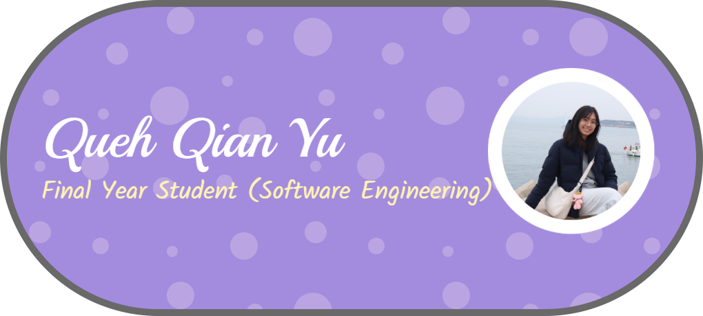

## Hi there 👋

## Introduction

I’m a student in WIF3005 Software Maintenance and Evolution course.
 
My expectations of this course is to gain a solid understanding of software maintenance and evolution, including different maintenance techniques, tools and strategies for improving and managing legacy software systems. I also hope to apply these concepts to real-world software projects and develop better skills in maintaining software quality and reliability.

About myself as a Software Engineering student: I am interested in software development, problem-solving and learning new technologies to build practical and reliable software solutions.

## 🛠️ Technical Skills

### 💻 Languages

### 🎨 Frameworks & Libraries

### 🧠 Software Engineering Knowledge
- Project Management
- Software Requirements Engineering
- Algorithms and Problem Solving
- Software Modelling
- Python Computing
- Software Testing

## GitHub Stats

